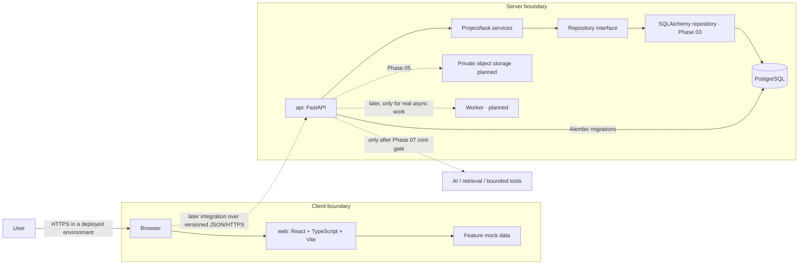

# OpsDesk architecture

## Current boundary



The browser UI still uses its feature-local mock-data boundary; it does not call the API yet. The independent versioned FastAPI app uses Pydantic transport schemas, application services, and a repository protocol. Phase 03 adds a SQLAlchemy/PostgreSQL repository, Alembic migrations, and transactionally written audit events. The migration models Workspace, Membership, Project, Task, Document metadata, and AuditEvent. Current project/task endpoints use one configured local workspace because auth and workspace selection are not implemented; the structural tables do not provide authentication, authorization, or tenant isolation. Document metadata does not store file bytes and has no CRUD routes. PostgreSQL credentials stay server-side. Frontend/API integration remains a later phase.

## Initial frontend flow

The shared app shell routes users between Dashboard, Projects, Project Detail, Documents, and Settings. Feature modules own their mock records and UI state. The Phase 02 HTTP contract is under `/api/v1`; a later integration phase will add a typed `web/src/api/` client and replace mock adapters at the feature data boundary without importing Python or backend runtime code.

## Phase 02–03 API and persistence structure

`api/src/opsdesk_api/` separates environment settings/application construction (`config.py`, `main.py`), HTTP routers (`routers/`), transport models (`schemas/`), business rules (`services/`), repository contract/implementations (`repositories/`), SQLAlchemy metadata/session management (`database/`), and error/request logging. Production app construction selects PostgreSQL and checks connectivity during startup; it never falls back to memory. Test code can inject the explicit in-memory adapter for isolated API contract tests. Alembic migrations under `api/migrations/` are the only schema-creation path. The process-health `/health` route does not check PostgreSQL. API operations are currently scoped to the configured default workspace, with no auth/authorization boundary yet.

The local default workspace is seeded by the initial migration with a stable UUID also used by the API configuration. Project/task audit events are written in the same SQLAlchemy transaction as each mutation, so failure of either write rolls the transaction back. Project deletion is not exposed; schema foreign keys use restrictive behavior rather than cascading core data. A nullable document-to-project foreign key uses `SET NULL` to retain metadata if its project is later removed through a future administrative path.

## Product flow sketches

```text
Dashboard → Projects → Project Detail → Create/edit task → visible success
Dashboard → Documents → search/filter → document detail (future)
Shared navigation → Settings (workspace preferences placeholder)
Future: Sign in → Workspace Dashboard (identity and authorization are later phases)
```

## Deployment topology (target, not implemented)

Deploy the static frontend and FastAPI API independently, with PostgreSQL and private object storage on managed services appropriate to the project. Configure the frontend API base URL at build/deployment time; keep credentials only in server-side secret storage. Add health checks, migrations, backups, monitoring, and rollback procedures in Phase 07. Do not add a worker until a genuinely asynchronous workflow exists.
