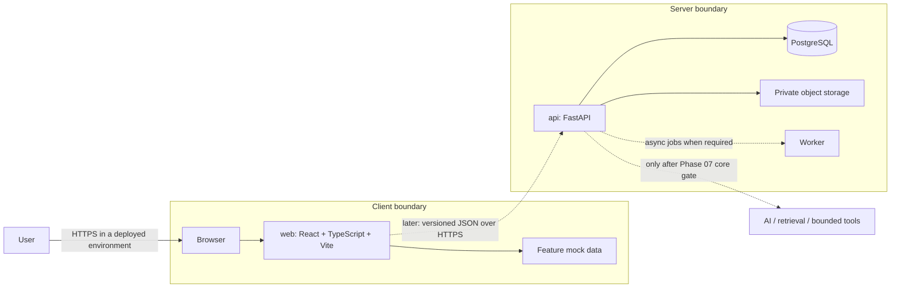

# OpsDesk architecture

## Current boundary



The implemented scope is only the browser UI and mock-data boundary. The API, database, storage, worker, and AI nodes are planned, not present. The browser must not contain secrets. In the deployed core, authorization and tenant isolation belong in the API; private documents and database credentials stay server-side. The frontend and backend will build, test, and deploy independently from this monorepo.

## Initial frontend flow

The shared app shell routes users between Dashboard, Projects, Project Detail, Documents, and Settings. Feature modules own their mock records and UI state. A future `web/src/api/` client will implement an explicit, versioned HTTP contract; it will replace the mock adapters without importing Python or backend runtime code.

## Product flow sketches

```text
Dashboard → Projects → Project Detail → Create/edit task → visible success
Dashboard → Documents → search/filter → document detail (future)
Shared navigation → Settings (workspace preferences placeholder)
Future: Sign in → Workspace Dashboard (identity and authorization are later phases)
```

## Deployment topology (target, not implemented)

Deploy the static frontend and FastAPI API independently, with PostgreSQL and private object storage on managed services appropriate to the project. Configure the frontend API base URL at build/deployment time; keep credentials only in server-side secret storage. Add health checks, migrations, backups, monitoring, and rollback procedures in Phase 07. Do not add a worker until a genuinely asynchronous workflow exists.
