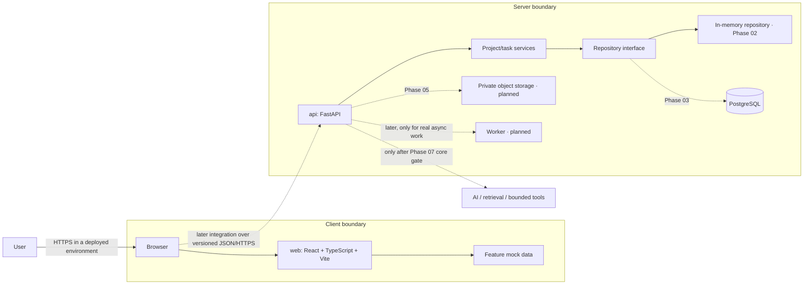

# OpsDesk architecture

## Current boundary



The browser UI still uses its feature-local mock-data boundary; it does not call the API yet. Phase 02 now implements an independent versioned FastAPI app for health, project, and task operations. It uses Pydantic transport schemas, application services, a repository protocol, and an in-memory repository that resets on process restart. The API does not provide durable persistence, authentication, authorization, document storage, or frontend integration. PostgreSQL and migrations belong to Phase 03; identity and tenant isolation belong to Phase 04. The browser must not contain secrets. In the deployed core, authorization and tenant isolation belong in the API; private documents and database credentials stay server-side. The frontend and backend build, test, and deploy independently from this monorepo.

## Initial frontend flow

The shared app shell routes users between Dashboard, Projects, Project Detail, Documents, and Settings. Feature modules own their mock records and UI state. The Phase 02 HTTP contract is under `/api/v1`; a later integration phase will add a typed `web/src/api/` client and replace mock adapters at the feature data boundary without importing Python or backend runtime code.

## Phase 02 API structure

`api/src/opsdesk_api/` separates settings and application construction (`config.py`, `main.py`), HTTP routers (`routers/`), request/response models (`schemas/`), business rules (`services/`), repository contracts and the in-memory implementation (`repositories/`), and error/request logging (`errors.py`, `middleware.py`, `logging_config.py`). The `/health` route reports process availability only. All project/task records are ephemeral. No database or auth dependency is introduced before its tracker phase.

## Product flow sketches

```text
Dashboard → Projects → Project Detail → Create/edit task → visible success
Dashboard → Documents → search/filter → document detail (future)
Shared navigation → Settings (workspace preferences placeholder)
Future: Sign in → Workspace Dashboard (identity and authorization are later phases)
```

## Deployment topology (target, not implemented)

Deploy the static frontend and FastAPI API independently, with PostgreSQL and private object storage on managed services appropriate to the project. Configure the frontend API base URL at build/deployment time; keep credentials only in server-side secret storage. Add health checks, migrations, backups, monitoring, and rollback procedures in Phase 07. Do not add a worker until a genuinely asynchronous workflow exists.
