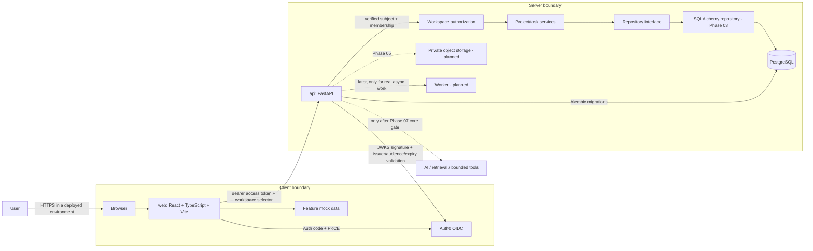

# OpsDesk architecture

## Current boundary



Auth0 authenticates users through OIDC authorization code + PKCE. The React SDK caches access tokens in memory and calls `GET /api/v1/workspaces` before showing the workspace shell. The API validates the token signature against Auth0 JWKS and checks issuer, audience, expiry, issued-at, and subject. It maps `(issuer, sub)` to a PostgreSQL membership; email is not an authorization key. `X-Workspace-ID` is only a selection hint: membership is required, and each request builds a workspace-scoped repository. Roles are `owner` and `member`; members can use project/task operations, while owner-only API operations can manage membership. Initial owner provisioning uses a privileged command after an operator verifies the provider subject. See ADR 0002 for trust boundaries and trade-offs.

Project/task list and CRUD data in the web UI still uses feature-local mock adapters. The frontend only calls the API to verify the signed-in identity's workspace memberships; it does not replace project/task data flows. PostgreSQL models Workspace, Membership, Project, Task, Document metadata, and AuditEvent. Authenticated document access currently returns workspace-scoped metadata only; there is no file-byte storage or download route until the storage phase. Workspace members may delete tasks; a project with tasks cannot be deleted, and deleting an empty project preserves and detaches associated document metadata. PostgreSQL credentials and OIDC server configuration stay on the backend. Full frontend/API integration remains a later phase.

## Initial frontend flow

The shared app shell routes users between Dashboard, Projects, Project Detail, Documents, and Settings. Feature modules own their mock records and UI state. The Phase 02 HTTP contract is under `/api/v1`; a later integration phase will add a typed `web/src/api/` client and replace mock adapters at the feature data boundary without importing Python or backend runtime code.

## Phase 02–04 API, persistence, and identity structure

`api/src/opsdesk_api/` separates settings/application construction, OIDC token validation (`auth.py`), routers, transport schemas, services, repository contract/implementations, SQLAlchemy metadata/session management, and safe request logging. Production app construction selects PostgreSQL and checks connectivity during startup; it never falls back to memory. Test code can inject the explicit in-memory adapter for API contract tests, while workspace authorization integration tests require an isolated PostgreSQL `*_test` database. Alembic migrations are the only schema-change path. `/health` is intentionally public and reports process health, not database readiness. Protected routes require a verified bearer token and matching workspace membership.

The local default workspace is seeded by the initial migration with a stable UUID. Migration `20261012_0002` adds issuer/subject identity to memberships and allows email to be absent. Project/task audit events record the acting membership in the same transaction as each mutation, including deletes. Task deletion and empty-project deletion are workspace-scoped; the project→task foreign key restricts deletion while tasks exist, and document metadata remains in its workspace with `project_id` set null when its project is deleted.

## Product flow sketches

```text
Dashboard → Projects → Project Detail → Create/edit task → visible success
Dashboard → Documents → search/filter → document detail (future)
Shared navigation → Settings (workspace preferences placeholder)
Sign in → backend token validation → membership lookup → workspace-scoped API access
```

## Deployment topology (target, not implemented)

Deploy the static frontend and FastAPI API independently, with PostgreSQL and private object storage on managed services appropriate to the project. Configure the frontend API base URL at build/deployment time; keep credentials only in server-side secret storage. Add health checks, migrations, backups, monitoring, and rollback procedures in Phase 07. Do not add a worker until a genuinely asynchronous workflow exists.
